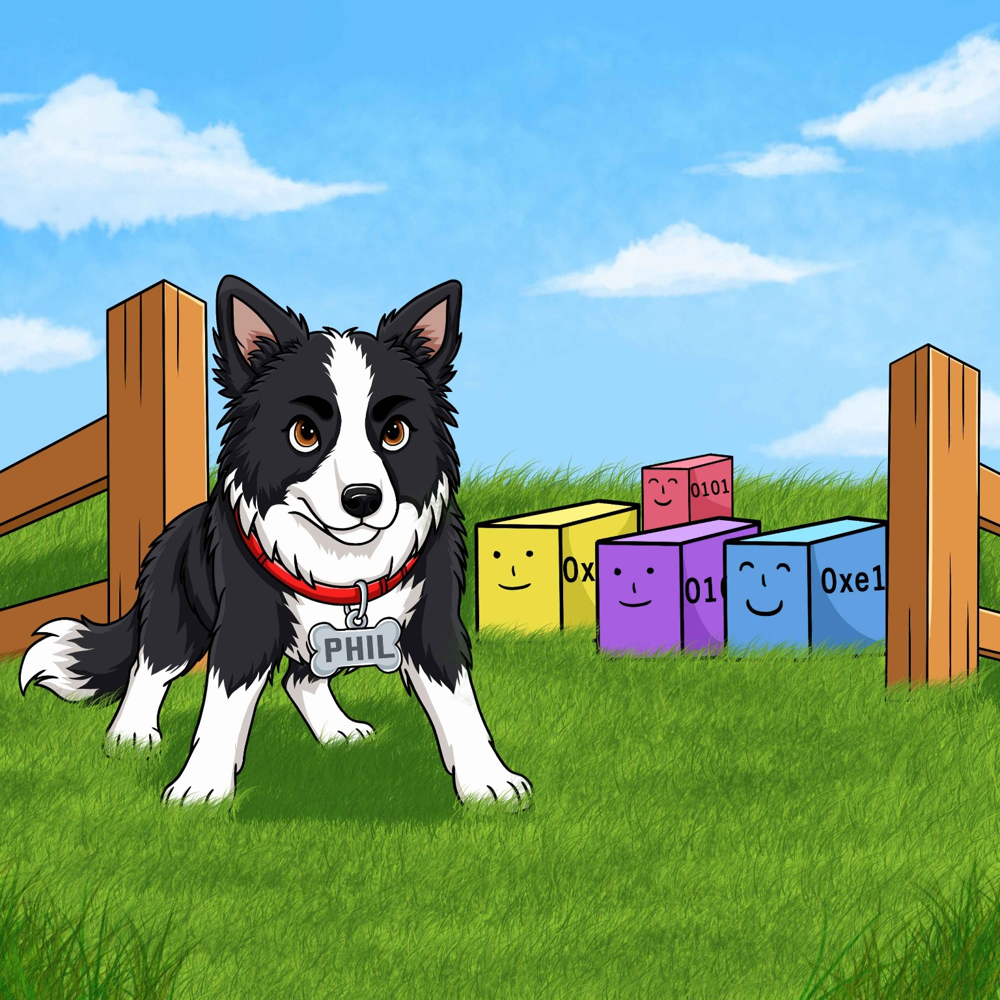
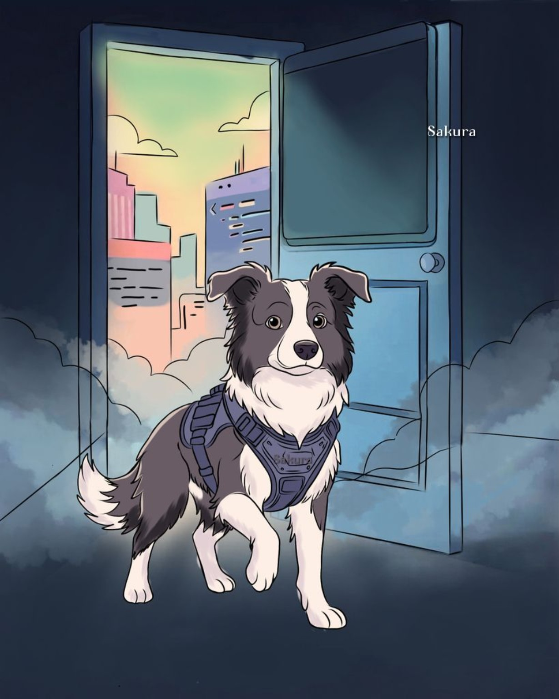
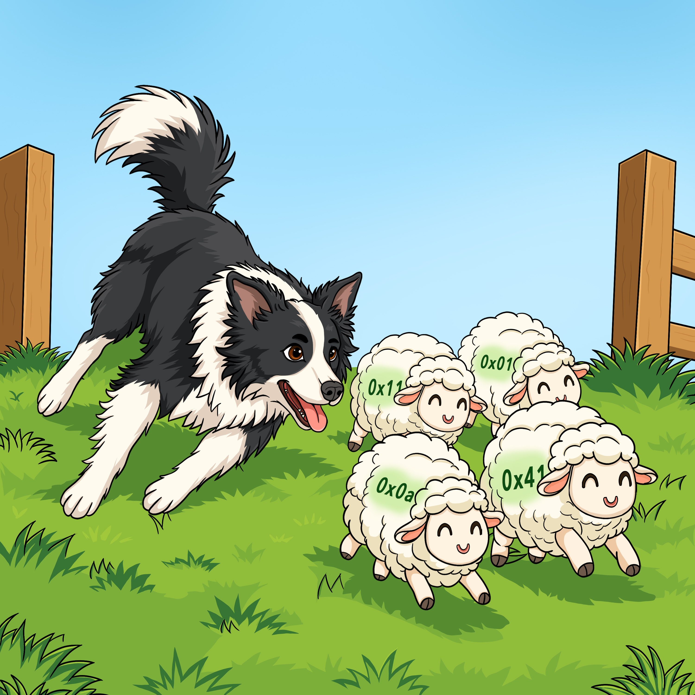
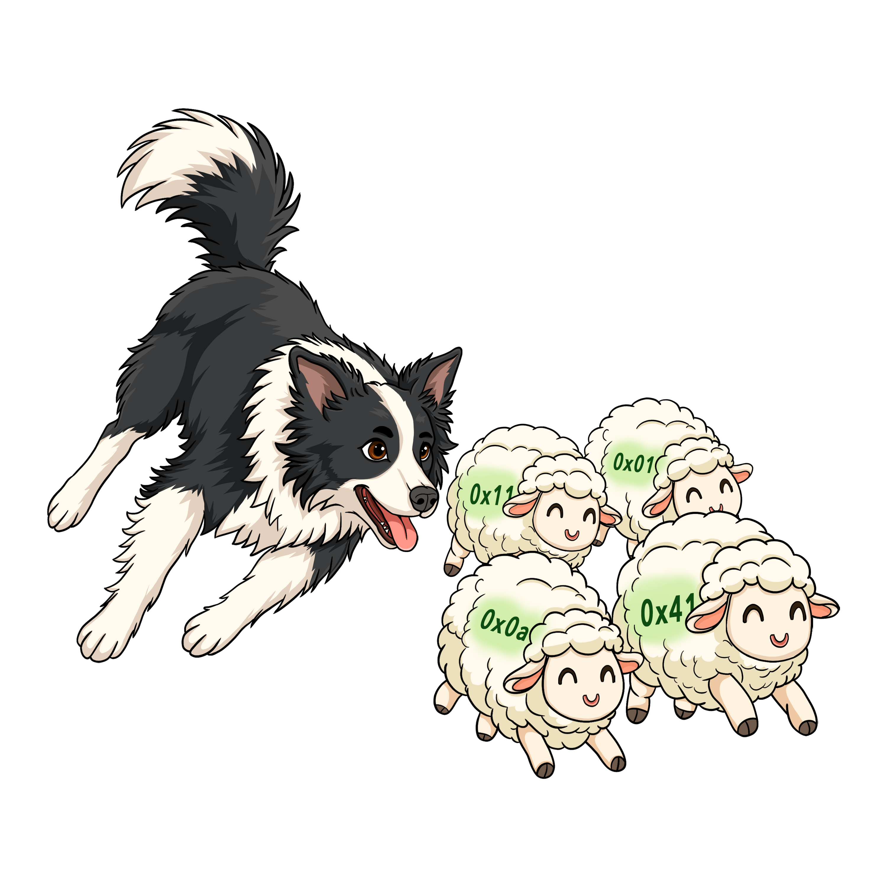

# Phil mascot gallery

Phil's mascot is a friendly black-and-white border collie. These illustrations are credited individually to their artists, and their filenames make attribution easy to retain when used in project documentation.

## Phil and the happy blocks

**Illustration: Josie Backett.** The border collie stands with a group of cheerful, code-labelled blocks. This is the illustration featured near the introduction to the [Phil README](../../README.md).

## Phil at the threshold

**Illustration: [SakuMuff](https://bsky.app/profile/sakuramuff.bsky.social).** A doorway scene, with a cityscape beyond it.

## Phil herding hexadecimal sheep

**Illustration: Railee Adams.** The art was supplied in a layered-source archive with finished background and transparent variants.

A transparent-background version is available for use in tutorials, slides and other layouts:

## Artwork credits and reuse

| Artist | Files |
| --- | --- |
| **Josie Backett** | `phil-and-blocks-josie-backett.jpg` |
| **[SakuMuff](https://bsky.app/profile/sakuramuff.bsky.social)** | `phil-at-the-door-sakumuff.jpg` |
| **Railee Adams** | `phil-herding-sheep-railee-adams.jpg`, `phil-herding-sheep-transparent-railee-adams.png` |

The illustrations remain credited to their respective artists. **Do not assume the artwork is Apache-2.0-licensed merely because it appears alongside Apache-2.0 source code and documentation.** No blanket permission to reuse, modify, sell, or redistribute these works is asserted here. Contact the artists or the Phil project maintainers before reusing these images outside Phil's own project materials.

See [asset provenance](../assets/mascots/README.md) for filenames and source details.
